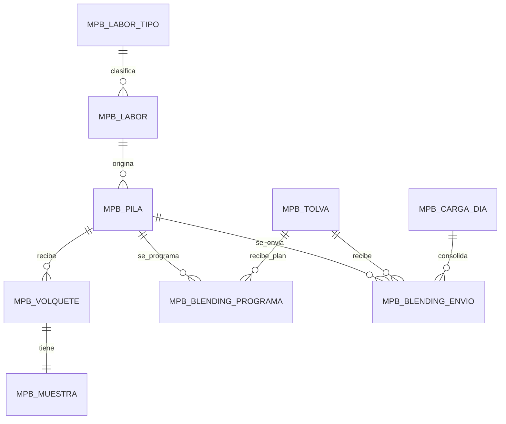

# Especificaciones: Muestreo de Pilas y Blending (MPB)

Esta carpeta contiene una especificación por feature del backlog priorizado con WSJF. Cada especificación desarrolla las capas 4 y 5 de SDD (especificación funcional y especificación técnica preliminar) de sus historias de usuario y las traza hasta los criterios de aceptación.

| Versión | Estado | Fecha |
|---------|--------|-------|
| 0.1 | Borrador | 2026-10-15 |

## Índice

| Rank WSJF | Spec | Feature | HU cubiertas | Incremento |
|---:|------|---------|--------------|------------|
| 1 | [SPEC-F01](SPEC-F01_configuracion-de-pilas.md) | Configuración de pilas | HU-F01-1, HU-F01-2 | MVP 1 |
| 2 | [SPEC-F02](SPEC-F02_registro-de-volquetes.md) | Registro de volquetes | HU-F02-1, HU-F02-2 | MVP 1 |
| 3 | [SPEC-F03](SPEC-F03_registro-de-muestras.md) | Registro de muestra por volquete | HU-F03-1, HU-F03-2 | MVP 1 |
| 4 | [SPEC-F04](SPEC-F04_ley-ponderada-de-pila.md) | Ley ponderada de pila | HU-F04-1, HU-F04-2 | MVP 1 |
| 5 | [SPEC-F09](SPEC-F09_seguridad-y-auditoria.md) | Seguridad y roles | HU-F09-1, HU-F09-2 | MVP 1 |
| 6 | [SPEC-F06](SPEC-F06_carga-del-dia.md) | Carga del día | HU-F06-1, HU-F06-2 | MVP 2 |
| 7 | [SPEC-F05](SPEC-F05_blending-a-tolvas.md) | Registro de blending a tolvas | HU-F05-1, HU-F05-2 | MVP 2 |
| 8 | [SPEC-F08](SPEC-F08_trazabilidad.md) | Trazabilidad | HU-F08-1, HU-F08-2 | MVP 2 |
| 9 | [SPEC-F07](SPEC-F07_integracion-laboratorio.md) | Integración con laboratorio | HU-F07-1, HU-F07-2 | Evolución |
| 10 | [SPEC-F10](SPEC-F10_reportes-y-tablero.md) | Reportes / tablero | HU-F10-1, HU-F10-2 | Evolución |
| 11 | [SPEC-F11](SPEC-F11_integracion-sig.md) | Integración con SIG | HU-F11-1, HU-F11-2 | Evolución |

Orden de construcción sugerido (respeta dependencias): F01 → F02 → F03 → F04 → F09 → F05 → F06 → F08 → F07 → F10 → F11.

## Convenciones

| Elemento | Formato | Ejemplo |
|----------|---------|---------|
| Regla de negocio | `RN-Fxx-nn` | RN-F01-02 |
| Requisito funcional | `RF-Fxx-nn` | RF-F02-01 |
| Requisito no funcional | `RNF-nn` (comunes, ver abajo) | RNF-03 |
| Caso de prueba | `CP-Fxx-nn` | CP-F04-05 |
| Criterio de aceptación | `HU-Fxx-n / CAn` | HU-F01-1 / CA4 |

Stack de referencia: Blazor (front) + ASP.NET Core Web API (back) + Dapper sobre SQL Server, según los estándares de desarrollo, seguridad y base de datos de CMH.

## Glosario

| Término | Definición |
|---------|-----------|
| Labor | Frente de explotación del que proviene el mineral (tajeo, galería, etc.). |
| Pila / polígono | Acumulación de mineral de una labor, identificada como un polígono en el SIG. |
| Volquete | Unidad de transporte que lleva una carga de mineral a una pila. |
| Muestra | Porción tomada de cada volquete para determinar su ley. |
| Ley | Contenido de metal en el mineral (inicialmente Au en g/t). |
| Ley ponderada | Σ(ley × tonelaje) / Σ tonelaje. |
| Tolva | Depósito que alimenta la planta. |
| Blending | Mezcla de pilas que se envía a las tolvas para lograr una ley objetivo. |
| Carga del día | Suma de lo enviado a todas las tolvas en una fecha de operación. |
| Ley de cabeza | Ley ponderada de la carga del día. |

## Estados

| Entidad | Código | Estado | Transiciones permitidas |
|---------|--------|--------|------------------------|
| Pila | `ABI` | Abierta | → `CER` |
| Pila | `CER` | Cerrada | → `CON` (automática al llegar el stock a 0) |
| Pila | `CON` | Consumida | Final |
| Muestra | `PEN` | Pendiente de ley | → `LEY` |
| Muestra | `LEY` | Con ley | Corrección de ley con motivo, mientras la pila esté `ABI` |
| Día de operación | `ABI` | Abierto | → `CER` |
| Día de operación | `CER` | Cerrado | Final |

## Modelo de datos común

Esquema preliminar `planta`, prefijo `MPB` (por confirmar con el DBA). Todas las tablas incluyen las columnas de auditoría `CUSUARIO_CREACION`, `DFECHA_CREACION`, `CUSUARIO_MODIFICACION` y `DFECHA_MODIFICACION`.



El detalle de columnas de cada tabla está en la especificación que la crea.

## Requisitos no funcionales comunes

| ID | Requisito |
|----|-----------|
| RNF-01 | Toda regla de negocio se valida en el servidor; la interfaz solo anticipa la validación. |
| RNF-02 | Toda operación que modifica varias tablas se ejecuta en una sola transacción (`TRY...CATCH`, `XACT_ABORT ON`, `ROLLBACK` ante error). |
| RNF-03 | Los valores de tonelaje y ley usan `DECIMAL`, nunca `FLOAT`. |
| RNF-04 | El acceso se controla por ventana y acción según SIA (ver SPEC-F09). |
| RNF-05 | Las altas, modificaciones y cierres de datos críticos quedan auditados (ver SPEC-F09). |
| RNF-06 | Las consultas de grillas responden en menos de 2 s con hasta 10 000 registros, con paginación en el servidor. |
| RNF-07 | Los errores de negocio se devuelven con un código y un mensaje claro (HTTP 409/422); no se enmascaran como errores genéricos. |
| RNF-08 | La interfaz sigue el sistema de diseño corporativo de CMH y funciona en tablet (uso en balanza y cancha). |

## Formato de error de la API

```json
{
  "codigo": "PILA_CERRADA",
  "mensaje": "La pila PIL-TJ01-20261015-001 está cerrada y no admite volquetes.",
  "detalle": null
}
```

## Trazabilidad

Necesidad de negocio → HU → criterio de aceptación → regla / requisito funcional → objeto técnico → caso de prueba. Cada especificación incluye su matriz.
